

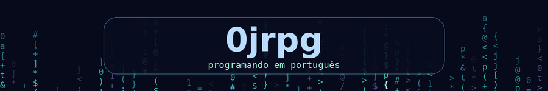


 

<b>🎓 EducaTurdi: o que é</b>

 

Plataforma escolar moderna e integrada, feita em **Next.js + TypeScript**, com **Supabase (PostgreSQL)** no banco e deploy na **Vercel**. Tem identidade visual própria, microanimações e transições suaves, pra fugir do jeito dos sistemas escolares tradicionais. O foco é dar mais organização, praticidade, modernidade e conexão pra comunidade escolar.

📧 Quer um sistema assim pra sua escola? **EducaTurdi@gmail.com**

<b>🇧🇷 Alpha Language: o que é</b>

 

Uma linguagem brasileira que transforma arquivos `.alf` em aplicações web completas. Você escreve HTML, JS e Python num só código, em português, e o `tradutor.py` gera o `.html` pra você.

**Como rodar:** instale a dependência uma vez (`py -m pip install requests`), abra o `tradutor.py`, informe o nome do `.alf` e depois o nome do `.html` de saída (sem a extensão). O `dicionario.md` explica cada comando.



 

<table>
<tr>
<td width="46%" align="center">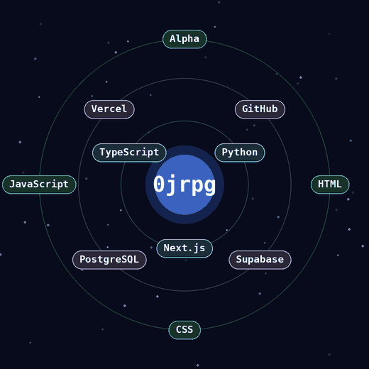</td>
<td width="54%" valign="top">

**Next.js + TypeScript** é a base de quase tudo: páginas, rotas, componentes e tipos.

**Supabase + PostgreSQL** guardam os dados do EducaTurdi. Em outros projetos prefiro nem ter banco: o próprio GitHub guarda o conteúdo.

**Python** entra no tradutor da linguagem **Alpha**, que converte `.alf` em HTML + JS.

**Vercel** cuida do deploy: build a cada push, URL pública e nenhuma infraestrutura pra manter.

**Interfaces liquid glass**: painéis translúcidos, esferas de luz em movimento e paleta que muda conforme o conteúdo.

</td>
</tr>
</table>

<b>🗂️ GitHub como backend</b>

 

No **joaoricardo**, qualquer arquivo é servido por URL direta e fica guardado num repositório público; a Vercel só roda o código do site. Sites inteiros (HTML + CSS + JS) funcionam com a estrutura de pastas preservada, cada arquivo com o `Content-Type` certo. O que não dá: `.php` e outras linguagens de servidor não executam, aparecem como texto.

<b>🔐 Login sem sistema de usuários</b>

 

No blog **névoa**, quem pode escrever é decidido **pelo próprio GitHub**: admin ou colaborador com permissão de escrita no repo. Zero senha própria, zero cadastro.

<b>🪪 Páginas de bio com links</b>

 

O **biohtml** é uma bio com links acessíveis, feita em HTML e programada por mim. Dá pra fazer uma pra qualquer pessoa.


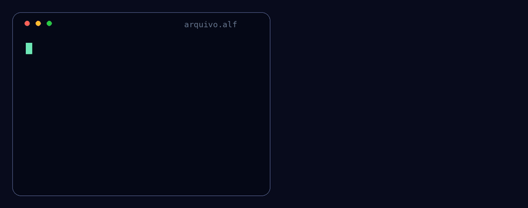

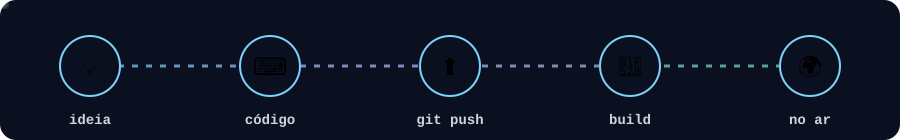


<table>
<tr>
<td width="50%" align="center">

</td>
<td width="50%" align="center">

</td>
</tr>
</table>

também por aqui: <a href="https://github.com/0jrpg/blog">névoa</a>, um blog liquid glass em Next.js (<a href="https://blognevoa.vercel.app">blognevoa.vercel.app</a>)

<b>🔭 como o joaoricardo funciona por dentro</b>

 



<a href="https://github.com/alphalanguage/alf"></a>

