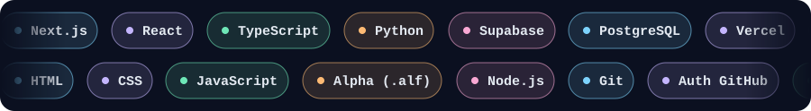
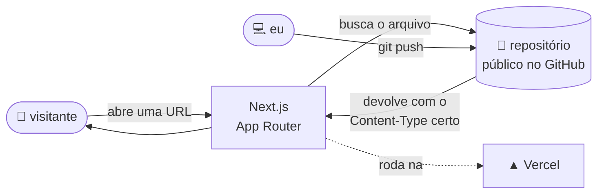
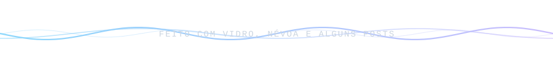

<div align="center">



<a href="https://github.com/0jrpg"></a>
<a href="https://github.com/alphalanguage/alf"></a>
<a href="https://educaturdi.vercel.app"></a>




</div>


## ⭐ em destaque

<div align="center">

<a href="https://github.com/EducaTurdi/EDUTRD"></a>

<br>

<a href="https://github.com/alphalanguage/alf"></a>

</div>

<details>
<summary><b>🎓 EducaTurdi: o que é</b></summary>
<br>

Plataforma escolar moderna e integrada, feita em **Next.js + TypeScript**, com **Supabase (PostgreSQL)** no banco e deploy na **Vercel**. Tem identidade visual própria, microanimações e transições suaves, pra fugir do jeito dos sistemas escolares tradicionais. O foco é dar mais organização, praticidade, modernidade e conexão pra comunidade escolar.

📧 Quer um sistema assim pra sua escola? **EducaTurdi@gmail.com**

</details>

<details>
<summary><b>🇧🇷 Alpha Language: o que é</b></summary>
<br>

Uma linguagem brasileira que transforma arquivos `.alf` em aplicações web completas. Você escreve HTML, JS e Python num só código, em português, e o `tradutor.py` gera o `.html` pra você.

```
<janela> #B0C4DE {login}
*usuario "Usuário"
*senha "Senha"
@entrar
&mensagem "Bem-vindo ao Alpha"
</janela>
```

**Como rodar:** instale a dependência uma vez (`py -m pip install requests`), abra o `tradutor.py`, informe o nome do `.alf` e depois o nome do `.html` de saída (sem a extensão). O `dicionario.md` explica cada comando.

</details>


## 🧭 com o que eu programo

Clica em cada bloco pra abrir 👇

<details>
<summary><b>🌐 Aplicações web com Next.js + TypeScript</b></summary>
<br>

Meu dia a dia é **Next.js (App Router)** com **TypeScript**: páginas, rotas, componentes e tipos. É a base do EducaTurdi, do site de arquivos e do blog névoa.

</details>

<details>
<summary><b>🗄️ Banco de dados com Supabase + PostgreSQL</b></summary>
<br>

No EducaTurdi uso **Supabase** em cima de **PostgreSQL** pros dados da plataforma escolar. Em outros projetos prefiro nem ter banco: o próprio GitHub guarda o conteúdo.

</details>

<details>
<summary><b>🔤 Linguagem de programação própria</b></summary>
<br>

A **Alpha** nasceu pra programar em português, sem acento fora de aspas e com sintaxe curta (`*campo`, `@botão`, `&mensagem`). Um tradutor em **Python** converte o `.alf` em HTML + JS prontos pra abrir no navegador.

</details>

<details>
<summary><b>🪪 Páginas de bio com links</b></summary>
<br>

O **biohtml** é uma bio com links acessíveis, feita em HTML puro e programada por mim. Dá pra personalizar uma pra qualquer pessoa.

</details>

<details>
<summary><b>🗂️ GitHub como backend</b></summary>
<br>

No **joaoricardo**, qualquer arquivo é servido por URL direta e fica guardado num repositório público; a Vercel só roda o código do site. Sites inteiros (HTML + CSS + JS) funcionam com a estrutura de pastas preservada, cada arquivo com o `Content-Type` certo. O que não dá: `.php` e outras linguagens de servidor não executam, aparecem como texto.

</details>

<details>
<summary><b>🪟 Interfaces "liquid glass"</b></summary>
<br>

Painéis translúcidos, esferas de luz em movimento e paleta que muda conforme o conteúdo. Foi a linguagem visual do blog **névoa**, onde cada post é um `.json` lido direto do GitHub.

</details>

<details>
<summary><b>🔐 Login sem sistema de usuários</b></summary>
<br>

No blog, quem pode escrever é decidido **pelo próprio GitHub**: admin ou colaborador com permissão de escrita no repo. Zero senha própria, zero cadastro.

</details>

<details>
<summary><b>🚀 Deploy na Vercel</b></summary>
<br>

Build automático a cada push, URL pública e nenhuma infraestrutura pra manter.

</details>


## 🧰 stack




## 🚧 mais projetos

<table>
<tr>
<td width="50%" align="center">
<a href="https://github.com/0jrpg/biohtml"></a>
</td>
<td width="50%" align="center">
<a href="https://github.com/0jrpg/joaoricardo"></a>
</td>
</tr>
</table>

<div align="center">
<sub>também por aqui: <a href="https://github.com/0jrpg/blog">névoa</a>, um blog liquid glass em Next.js (<a href="https://blognevoa.vercel.app">blognevoa.vercel.app</a>)</sub>
</div>

### 🔭 como o joaoricardo funciona por dentro




## 📊 números

<div align="center">


<br><br>

<picture>
  <source media="(prefers-color-scheme: dark)" srcset="https://raw.githubusercontent.com/0jrpg/0jrpg/output/github-snake-dark.svg"/>
  <source media="(prefers-color-scheme: light)" srcset="https://raw.githubusercontent.com/0jrpg/0jrpg/output/github-snake.svg"/>
  
</picture>

</div>


